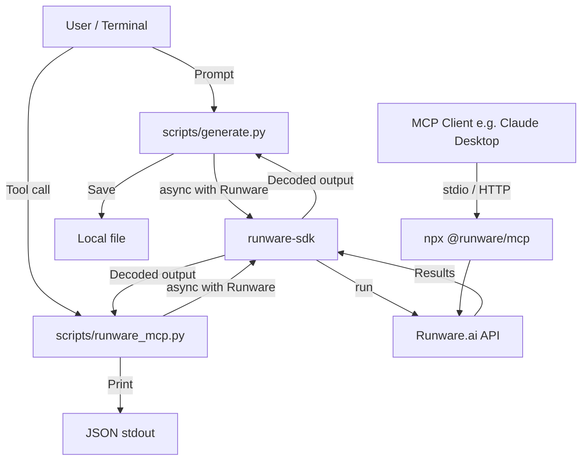

# runware-mcp

[](https://github.com/GeekLord/)
[](https://github.com/GeekLord/OpenClaw_Runware_API)
[](https://www.python.org/)

OpenClaw skill for media generation with the official Runware Python SDK (`runware-sdk`) and Model Context Protocol (MCP) tooling. Supports image, video, audio, text, and 3D generation.

This repository connects to the [Runware MCP server](https://runware.ai/mcp) and provides a Python CLI to generate media, browse models, check pricing, and check account balances.

## Capabilities

- Image, video, audio, text, and 3D generation
- Direct integration with `runware-sdk` (async and schema validated)
- MCP tool wrappers for `run`, `list-models`, `model-pricing`, `model-details`, and `account`
- Connection options for hosted MCP (`https://mcp.runware.ai`), local npm package (`@runware/mcp`), or local Python scripts
- Synchronous delivery for fast requests and asynchronous polling for long tasks
- Prompt guard for minor safety
- Configurable defaults in `skill-config.json`
- Unit test suite with pytest

## Quick start

```bash
# Install dependencies
pip install -r requirements.txt

# Set your API key
echo "RUNWARE_API_KEY=your_key_here" > .env

# Generate an image
python scripts/generate.py --prompt "A serene mountain landscape" --mode image --outfile landscape.png

# Generate a video
python scripts/generate.py --prompt "Waves crashing on a beach" --mode video --duration 8 --outfile waves.mp4

# Browse models via MCP CLI
python scripts/runware_mcp.py list-models --category image --search "flux"

# Check account balance
python scripts/runware_mcp.py account
```

## MCP server connection

### 1. Hosted server

Any MCP-compatible client can connect directly to Runware's hosted endpoint:

```json
{
  "mcpServers": {
    "runware": { "url": "https://mcp.runware.ai" }
  }
}
```

Authentication uses OAuth 2.1, keeping the API key inside the session.

### 2. Local Node package

```json
{
  "mcpServers": {
    "runware": {
      "command": "npx",
      "args": ["-y", "@runware/mcp"],
      "env": { "RUNWARE_API_KEY": "your-api-key" }
    }
  }
}
```

### 3. Local Python script

```json
{
  "mcpServers": {
    "runware-python": {
      "command": "python",
      "args": ["scripts/runware_mcp.py"]
    }
  }
}
```

## Files

| File | Purpose |
|------|---------|
| `scripts/generate.py` | CLI generator for all supported modalities |
| `scripts/runware_mcp.py` | MCP CLI tool interface |
| `skill-config.json` | Default settings (non-sensitive) |
| `SKILL.md` | Skill definition and integration docs |
| `tests/test_generate.py` | Unit and integration tests for generation |
| `tests/test_runware_mcp.py` | Unit tests for MCP CLI interface |
| `examples/` | Sample commands for each modality |

## Configuration

Default settings live in `skill-config.json`:

- `default_size`: default image dimensions (e.g. `"1024x1024"`)
- `default_format`: default output format (`png`, `jpg`, `mp4`, `wav`, `glb`)
- `default_output_dir`: default save location
- `last_output_dir`: automatically updated by the script after each save

## CLI reference

### `scripts/generate.py`

| Flag | Description |
|------|-------------|
| `--prompt` | Text prompt for generation |
| `--mode` | Generation mode: `image`, `video`, `audio`, `text`, or `3d` |
| `--model` | Model ID (e.g. `runware:400@1`) |
| `--size` | Dimensions (e.g. `1024x1024`) |
| `--sync` / `--no-sync` | Synchronous delivery vs asynchronous polling |
| `--duration` | Video duration in seconds |
| `--num-results` | Number of outputs to create |
| `--extra KEY VALUE` | Extra payload parameters (repeatable) |
| `--outfile` | Output file path |

### `scripts/runware_mcp.py`

| Command | Description |
|---------|-------------|
| `run --prompt "..."` | Run an inference task |
| `list-models` | Browse the model catalog |
| `model-pricing --model X` | Check pricing for a model |
| `model-details --model X` | Get model metadata |
| `account` | View account details and balance |

## Testing

Run unit tests:

```bash
pytest -q -m "not integration"
```

To run the live integration test, set `RUNWARE_API_KEY` in your environment:

```bash
pytest -q
```

## Safety

- Prompts referencing minors are blocked locally before sending requests.
- Requests must follow [Runware terms of service](https://runware.ai/terms).
- API keys stay in local `.env` files or OAuth sessions and are never committed to version control.

## Architecture



## Migration from v1.x

| Version 1.x | Version 2.0 |
|-------------|-------------|
| `scripts/generate_image.py` | `scripts/generate.py` |
| Direct HTTP calls to `/v1/tasks` | `runware-sdk` via `client.run()` |
| Manual request IDs and payload formatting | SDK schema validation and delivery handling |
| Image only | Image, video, audio, text, and 3D |
| Python 3.8+ | Python 3.11+ |

## Author

**Shobhit Kumar Prabhakar** ([@GeekLord](https://github.com/GeekLord/))

## License

MIT (see LICENSE)

## Links

- [Runware MCP Server](https://runware.ai/mcp)
- [Runware MCP Documentation](https://runware.ai/docs/platform/mcp)
- [Runware Python SDK](https://runware.ai/docs/platform/python)
- [Official @runware/mcp GitHub repository](https://github.com/runware/mcp)
